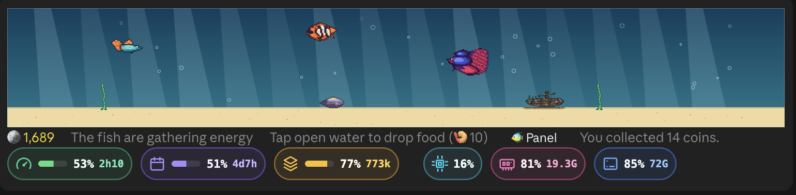

# claude-mods

Mods for Claude Code (CLI and the Desktop app's Code tab), each in its own folder under `mods/`.

| Mod | What it does |
|---|---|
| [pillbar](mods/pillbar) | A capsule band above the prompt: the 5-hour and weekly plan usage, this session's context window, and the machine's CPU, memory and disk. |
| [clawd-run](mods/clawd-run) | While Claude works on a long turn, Clawd plays a side-scrolling platformer above the prompt, with the turn's tokens and cost. |
| [token-tank](mods/token-tank) | A pixel-art aquarium above the prompt: Claude's turns feed the fish, the fish spit coins onto the sand and you pick them up; a shop, feeding and levels live in a pane (`/fish`). |
| [plain-narrator](mods/plain-narrator) | A pane where Haiku explains, in plain language, what Claude is doing, with a side chat you can ask using the model you pick (Haiku, Sonnet, Opus, Fable, or the main conversation itself). |

pillbar, clawd-run and token-tank share the band above the prompt and stack instead of replacing each other.



## Install

From a terminal session of Claude Code, one line per mod (`y` to add the marketplace, then pick a scope):

```
/plugin install token-tank --marketplace SheldonChangL/claude-mods
```

From a shell: `claude plugin install token-tank --marketplace SheldonChangL/claude-mods`. The same works for `pillbar`, `clawd-run` and `plain-narrator`.

In the desktop app, where `/plugin` does not run: click **+** next to the prompt box, then **Plugins**, **Add marketplace** with `SheldonChangL/claude-mods`, then **Add plugin**.

To run a mod from a checkout instead, point `CLAUDE_CODE_PLUGIN_DIRS` at the mods you want, colon-separated, in the `env` block of `~/.claude/settings.json`:

```json
{
  "env": {
    "CLAUDE_CODE_PLUGIN_DIRS": "/path/to/claude-mods/mods/pillbar:/path/to/claude-mods/mods/token-tank:/path/to/claude-mods/mods/plain-narrator"
  }
}
```

Then start a new session (on Desktop, restart the app).


pillbar's quota meters fill as soon as the engine reports usage. If the separate JetDeck mod is loaded, pillbar reads its daemon instead, so the meters fill without sending a message first; without it pillbar samples the machine itself.

## Develop

Each mod is self-contained. From a mod's folder:

```bash
claude plugin test .
claude plugin validate .
```
